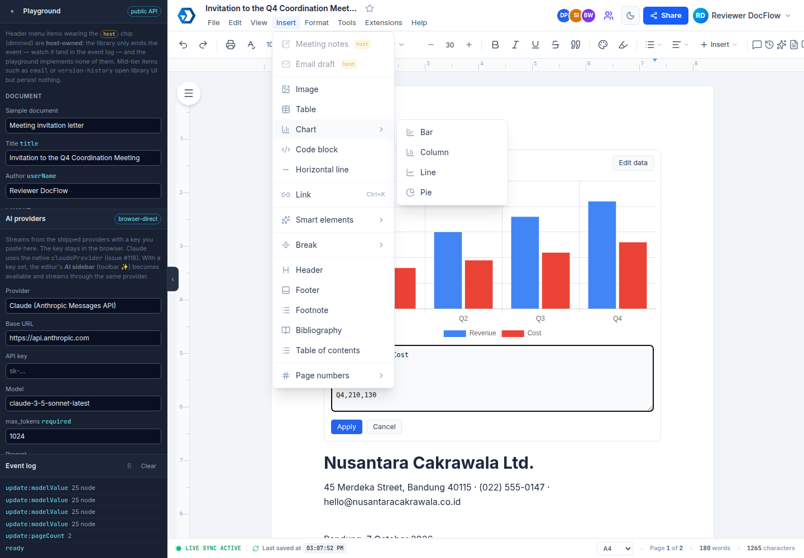

# Evidence: Issue #26 — Submenu "Chart" pada Menu Insert

Implementasi fitur penambahan submenu **Insert ▸ Chart** dengan pilihan tipe **Bar**, **Column**, **Line**, dan **Pie** menggunakan **Chart.js**.

## Eviden Visual

1. **Menu Insert ▸ Chart (Bar, Column, Line, Pie)**:
   

2. **Render Grafik Live (Chart.js Canvas + Preview PNG untuk Export DOCX/HTML)**:
   - Ter-render di editor dengan toolbar tipe & tombol *Edit data*.
   - Editor CSV inline untuk mengubah label & nilai series.

## Daftar File yang Terdampak

| Modul / File | Perubahan Utama |
| --- | --- |
| `packages/plugins/package.json` | Menambahkan dependensi `chart.js ^4.5.1`. |
| `packages/plugins/src/chartData.ts` | Model data chart, parser CSV, dan builder config Chart.js. |
| `packages/plugins/src/chartNode.ts` | Definisi ProseMirror Node (`chart`), atribut `preview`, dan serialization. |
| `packages/plugins/src/chartNodeView.ts` | Node view DOM dengan Chart.js lazy load, switch tipe, dan inline CSV editor. |
| `packages/plugins/src/chart.ts` | Plugin definition + command `insertChart(kind)`. |
| `packages/plugins/src/index.ts` | Ekspor plugin & modul chart, serta dimasukkan ke `defaultPlugins`. |
| `packages/plugins/src/__tests__/chart.test.ts` | Unit test untuk parser data, CSV, config, dan registrasi plugin (9 tests pass). |
| `packages/export/src/docx/image.ts` | Fungsi `decodeDataUrl` untuk mendukung export base64 data URL PNG (preview chart). |
| `packages/export/src/docx/index.ts` | Cabang proses export node `chart` sebagai gambar statis ke DOCX. |
| `packages/export/src/__tests__/chartExport.test.ts` | Test export DOCX dengan chart node (5 tests pass). |
| `packages/vue/src/components/menuStructure.ts` | Penambahan submenu Insert ▸ Chart (Bar, Column, Line, Pie) dengan ikon Lucide. |
| `packages/vue/src/composables/useEditCommands.ts` | Wiring action `insert-chart-{bar,column,line,pie}` ke plugin command. |
| `packages/vue/src/locales/en.ts` & `id.ts` | Terjemahan label menu chart. |
| `packages/vue/src/styles/index.css` | Styling `.docs-chart` (toolbar, select, editor textarea, dark mode). |

## Panduan Pengujian (How to Test)

1. Jalankan playground: `pnpm --filter @kedata-indonesia/docflow-playground dev:source` (atau build).
2. Buka browser di `http://localhost:5200`.
3. Klik **Insert** di menu header utama, arahkan ke **Chart**.
4. Pilih salah satu tipe chart (**Bar**, **Column**, **Line**, atau **Pie**).
5. Chart akan muncul di posisi kursor dengan data sample default.
6. Klik tombol **Edit data** pada chart untuk membuka editor CSV inline, ubah nilai/label, lalu klik **Apply**.
7. Ubah dropdown tipe chart di pojok kiri atas chart block untuk berganti tampilan secara reaktif.
8. Uji export DOCX/HTML untuk memastikan preview chart terekspor dengan benar.
